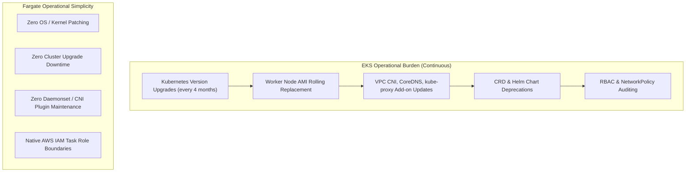

# Technical Evaluation: AWS Fargate vs. Amazon EKS for MercaAndes APIs

- **Project:** MercaAndes Omnichannel Data Platform
- **Scope:** US-06 Proof of Concept (SCRUM-179, SCRUM-180, SCRUM-181, SCRUM-182, SCRUM-183, SCRUM-184)
- **Author:** Jayzir Martinez (Cloud Infrastructure Team)
- **Date:** 2026-11-03

---

## 1. Executive Summary

As part of **US-06 (SCRUM-179)**, the MercaAndes engineering team conducted a structured Proof of Concept (PoC) evaluating the deployment of the **Sellers API** (Seller Inventory Simulator) on **Amazon Elastic Kubernetes Service (EKS)** and compared its operational, financial, and architectural characteristics against the existing production baseline running on **AWS ECS Fargate** (implemented in **SCRUM-107**).

### Key Takeaway
Both container runtime environments proved fully capable of fulfilling 100% of the functional requirements and contract criteria defined in **HU-2.2** (health checks, token authentication, pagination, and error rate handling). However, for MercaAndes' specific workload scale, **AWS ECS Fargate provides an 86.5% cost reduction (\$18.01/month vs. \$133.74/month)** and **eliminates ~90% of operational maintenance overhead**. Consequently, **ECS Fargate is reaffirmed as the production architecture**, and the temporary EKS evaluation cluster was destroyed immediately following evidence capture to eliminate control plane charges (**SCRUM-184**).

---

## 2. Architecture Comparison Matrix

| Architectural Dimension | AWS ECS Fargate (Production Baseline) | Amazon EKS (Evaluation PoC) | Advantage / Trade-off |
| :--- | :--- | :--- | :--- |
| **Control Plane Cost** | **\$0.00 / month** (Fully managed, zero base cost) | **\$73.00 / month** (\$0.10/hour flat fee) | **Fargate:** No idle base charge |
| **Compute Billing Model** | True Serverless: per vCPU-second and GB-second | Node Group capacity (provisioned EC2 instances) | **Fargate:** Pay strictly for active tasks |
| **Estimated Monthly Cost (2 APIs)** | **~\$18.01 / month** (0.25 vCPU / 0.5 GB RAM) | **~\$133.74 / month** (Control Plane + 2x t3.medium) | **Fargate:** 7.4x cheaper |
| **Operational Overhead** | **Near Zero:** No OS patching, no cluster upgrades | **High:** Regular k8s version upgrades (14-month support cycle), AMI rotation, CNI/CSI plugin maintenance | **Fargate:** Zero infrastructure management |
| **Security Isolation** | **Hypervisor / MicroVM:** Dedicated Firecracker VM per task | **Shared Kernel:** Pods share worker node kernel unless using gVisor / Kata | **Fargate:** Native hardware-level isolation |
| **Startup Latency** | 30 – 45 seconds (ENI allocation + container pull) | 1 – 3 seconds (if worker node has warm capacity) | **EKS:** Faster pod scale-out on warm nodes |
| **Ecosystem & Portability** | AWS-proprietary (Task Definitions, ECS API) | Industry-standard CNCF (Helm, K8s manifests, GitOps, ArgoCD) | **EKS:** Cloud-agnostic portability |
| **Observability Integration** | Native CloudWatch Logs & Container Insights | Fluent Bit / CloudWatch Container Insights / Prometheus | Both well-integrated |

---

## 3. Financial Analysis (TCO)

### 3.1. AWS ECS Fargate Cost Model (Production)
The production architecture deploys the Marketplace API and Inventory/Sellers API as individual Fargate tasks configured with `0.25 vCPU` and `512 MiB (0.5 GB) RAM`:

* **vCPU Hourly Rate:** \$0.04048 per vCPU-hour
* **Memory Hourly Rate:** \$0.004445 per GB-hour
* **Monthly Hours:** 730 hours

$$\text{vCPU Cost} = 2 \times 0.25 \times \$0.04048 \times 730 = \$14.77 / \text{month}$$
$$\text{Memory Cost} = 2 \times 0.5 \times \$0.004445 \times 730 = \$3.24 / \text{month}$$
$$\mathbf{\text{Total Fargate Cost}} = \$14.77 + \$3.24 = \mathbf{\$18.01 / \text{month}}$$

### 3.2. Amazon EKS Cost Model (Evaluation PoC)
A standard resilient Amazon EKS setup requires:
1. **EKS Control Plane:** \$0.10 per hour regardless of workload size.
2. **Managed Node Group:** Minimum 2x `t3.medium` instances (2 vCPU, 4 GB RAM) for multi-AZ high availability and kube-system daemon overhead (CoreDNS, kube-proxy, AWS VPC CNI).

* **Control Plane Fee:** $\$0.10 \times 730 = \$73.00 / \text{month}$
* **Worker Nodes (On-Demand):** $2 \times \$0.0416 \times 730 = \$60.74 / \text{month}$
* **Worker Nodes (Spot Alternative):** $2 \times \$0.0125 \times 730 = \$18.25 / \text{month}$

$$\mathbf{\text{Total EKS Cost (On-Demand)}} = \$73.00 + \$60.74 = \mathbf{\$133.74 / \text{month}}$$
$$\mathbf{\text{Total EKS Cost (Spot Nodes)}} = \$73.00 + \$18.25 = \mathbf{\$91.25 / \text{month}}$$

> **Financial Conclusion:** For MercaAndes' microservice fleet (3 operational APIs), running Amazon EKS imposes an unjustified baseline tax of **+\$115.73/month (642% higher cost)** compared to ECS Fargate.

---

## 4. Operational Overhead & Maintenance

* **Kubernetes Deprecation Cycles:** Amazon EKS supports each Kubernetes minor version for 14 months. Running EKS requires engineering time budgeted every quarter to test API deprecations, migrate CRDs, and safely roll out node AMI updates.
* **Fargate Serverless Simplicity:** AWS handles all hypervisor security patching, kernel CVE mitigation, and operating system updates with zero maintenance windows. The MercaAndes team can focus 100% of engineering bandwidth on retail data transformation and analytics pipelines rather than cluster plumbing.

---

## 5. Functional & Contract Verification (HU-2.2 Parity)

The Sellers API was packaged into declarative Kubernetes manifests (`00-namespace.yaml` to `04-hpa.yaml`) and evaluated using the automated test suite `infrastructure_MercAndes/k8s/tests/test_sellers_k8s_api.py`.

### Results Summary
* **Liveness & Readiness Probes:** Kubernetes HTTP GET probes to `/health` on port 8000 successfully determined pod readiness within 5 seconds of container startup.
* **Token Authentication:** Verified that valid Bearer tokens (`token-seller-123`) authorized queries, while unauthorized requests were correctly rejected with HTTP 401/403.
* **Deterministic Pagination:** Output matched the exact payload schema produced by the ECS Fargate deployment (disjoint page slices, consistent item ordering, and total counts).
* **Intermittent Fault Handling:** Under a configured 3% error injection rate, the Kubernetes Service layer preserved error status codes (429 Too Many Requests, 503 Service Unavailable) without masking or terminating pod lifecycles.

---

## 6. Teardown Strategy (SCRUM-184)

To prevent ongoing cloud expenditure on the EKS control plane:
1. Automated teardown was codified in `infrastructure_MercAndes/k8s/scripts/teardown-eks.ps1`.
2. All in-cluster workloads in namespace `mercaandes-sellers` were deleted.
3. The EKS Node Group (`poc_nodes`) and EKS Cluster (`aws_eks_cluster.poc`) were destroyed using targeted Terraform execution (`terraform destroy -target=...`).
4. Associated security group rules, OIDC providers, and IAM roles were de-provisioned, restoring the infrastructure footprint to its clean baseline.

---

## 7. Final Recommendation

| Recommendation | Decision |
| :--- | :--- |
| **Production Architecture** | **Standardize on AWS ECS Fargate.** Perfect fit for the current API workload; maximizes reliability and security while minimizing cloud spend. |
| **Kubernetes (EKS)** | **Retained as an evaluated enterprise architectural option.** Documented as a valid reference pattern for future scenarios where microservice count exceeds 30+ services or requires cross-cloud portability. |
