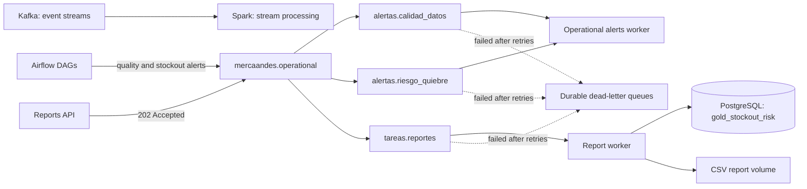

# Operational Messaging with RabbitMQ (US-03)

## Responsibility split

- **Kafka** carries marketplace and promotion event streams for Spark and other data-processing consumers. It supports partitioned replay and retained event history.
- **RabbitMQ** carries operational alerts and short background requests. Consumers acknowledge each message after processing it.
- **Airflow Celery** continues to use RabbitMQ as its task broker. The operational direct exchange is separate from Celery's queues and the existing purchase-notification queue.



## Exchanges and queues

The durable direct exchange `mercaandes.operational` uses each queue name as its routing key:

| Routing key / queue | Producer | Consumer |
| --- | --- | --- |
| `alertas.calidad_datos` | `bronze_to_silver_cleaning` when RN-10 removes duplicate marketplace events | `operational-alerts-worker` |
| `alertas.riesgo_quiebre` | `silver_to_gold_business_rules` after RN-04 stockout-risk calculation | `operational-alerts-worker` |
| `tareas.reportes` | `POST /api/v1/reports` on `reports-api` | `reports-worker` |

Every primary queue is durable and points to the durable exchange `mercaandes.operational.dlx`. Its dead-letter queue is named `<queue>.dlq`. Each route also has a durable `<queue>.retry` queue with a five-second TTL. Failed messages are republished with a retry counter up to three times; the next failure is sent to the DLQ. The publisher waits for broker confirms before acknowledging the original delivery.

All published messages use persistent delivery mode. Consumers use `auto_ack=False` and ACK only after successful processing. RabbitMQ stores queue data in the existing `rabbit-data` volume. These settings protect messages while consumers are stopped and preserve queued data across container restarts; they do not make a single local broker highly available.

The alerts worker appends successfully processed alerts to the `alerts-data` volume. The report worker creates a CSV file in `reports-data`. The initial report type is `stockout_risk`, sourced from `gold_stockout_risk`.

## Request a report

```http
POST http://localhost:8005/api/v1/reports
Content-Type: application/json

{"report_type":"stockout_risk"}
```

The API publishes a persistent message and returns HTTP 202 with a `job_id`. It does not wait for the report query or CSV generation. Completed CSV files are available inside the `reports-data` Docker volume as `<job_id>.csv`.

## Report data prerequisite

`reports-worker` reads `gold_stockout_risk` from the `merca_pos` database. The table is created by `postgres/init/02-gold-operational.sql` when the `pgdata` volume is initialized. If the volume already exists, apply the script once:

```powershell
docker compose exec -T postgres psql -U pos_user -d merca_pos < postgres/init/02-gold-operational.sql
```

The table must exist before a report request is consumed. Otherwise the message is retried three times and then moved to `tareas.reportes.dlq`.

## Ten-minute durability exercise

Run these commands from the infrastructure repository after creating `.env` and starting the stack. The script pauses the alert consumer, publishes five uniquely marked persistent alerts, verifies that all five are ready in RabbitMQ, waits ten minutes, restarts the consumer, and verifies that all five IDs were recorded before their ACKs.

```powershell
docker compose up -d --build rabbitmq operational-alerts-worker
.\scripts\rabbitmq-durability.ps1
```

To exercise the data-quality queue instead:

```powershell
.\scripts\rabbitmq-durability.ps1 -Queue alertas.calidad_datos
```

The script accepts `-WaitMinutes` for a shorter local smoke run. Use the default ten-minute wait for the acceptance criterion.

To verify bounded retries and dead-letter routing with an intentionally invalid alert:

```powershell
.\scripts\rabbitmq-dlq.ps1
```

## Automated tests

The service has unit tests for queue names, the message envelope, the retry decision, and alert validation. An optional integration test declares the topology against a running broker.

```powershell
cd services/operational-messaging
python -m pip install -r requirements.txt -r requirements-dev.txt
python -m pytest

# Optional integration check (RabbitMQ must be running and reachable):
$env:RUN_RABBITMQ_TESTS = "1"
python -m pytest -m integration
```

## Code layout

The service is intentionally flat:

| Module | Responsibility |
| --- | --- |
| `config.py` | Queue names, retry limits and DLQ helpers |
| `messages.py` | Standard message envelope |
| `rabbitmq.py` | Connection, topology, publisher and manual-ACK consumer |
| `alerts.py` | Alert consumer entrypoint |
| `reports.py` | Stockout-risk query, CSV writer and consumer entrypoint |
| `api.py` | FastAPI report endpoint |
| `publish_test_alerts.py` | Durability and DLQ test producer |

Delivery is at-least-once: a retry is published and confirmed before the original delivery is acknowledged. If the consumer dies between those two steps, the message is redelivered. Deduplicate by `message_id` if the alert log must be exact.
